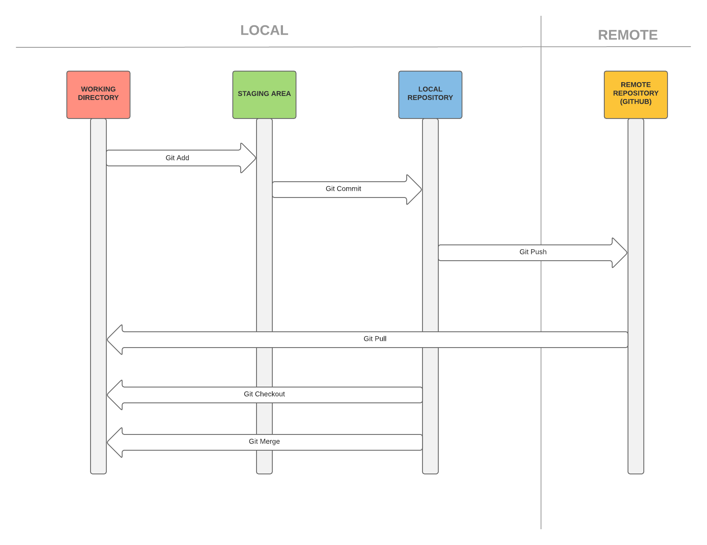
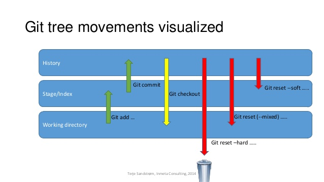

# Git

[GitHowto.com](https://githowto.com) · [Pro Git book](https://git-scm.com/book) · [Git docs](https://git-scm.com/docs)

Related notes: [Branching](2.git%20branch.md) · [Remotes](3.Remote.md) · [.gitignore](gitignore%20files.md) · [Dotfiles](dotfiles.md) · [CVS vs Git](cvs.md)



WorkFlow: **working directory** → `git add` → **staging area (index)** → `git commit` → **local repository** → `git push` → **remote**.

## First-time setup

```bash
git config --global user.name "Artur Badenes"
git config --global user.email "artur@example.com"
git config --global init.defaultBranch main     # new repos start on "main" instead of "master"
git config --global pull.rebase true            # git pull = fetch + rebase (false = merge, the default)
git config --global push.autoSetupRemote true   # first "git push" sets the upstream automatically
git config --global core.editor "code --wait"   # editor for commit messages, rebase -i...
git config --global core.excludesFile ~/.gitignore_global   # global ignore, see gitignore files.md

git config --global --list --show-origin        # show all settings and the file they come from
```

### Line endings (Windows)

```bash
git config --global core.autocrlf true    # Windows: CRLF in the working dir, LF in the repo
git config --global core.autocrlf input   # Linux/macOS: convert CRLF to LF on commit, never back
```

Better: commit a `.gitattributes` so the rule travels with the repo and doesn't depend on each user's config:

```gitattributes
# .gitattributes
* text=auto            # Git decides what is text and normalizes it to LF in the repo
*.sh  text eol=lf      # always LF (scripts must run on Linux)
*.bat text eol=crlf    # always CRLF
*.png binary           # never touch / never diff
```

```bash
git add --renormalize .   # re-apply the rules to files already committed
git commit -m "Normalize line endings"
```

## Start watching a directory for changes

Local:

```bash
git init            # creates .git/ in the current folder
git init my-project # creates the folder and the repo
```

On-line (copy an existing repo):

```bash
git clone https://github.com/user/repo.git
git clone git@github.com:user/repo.git        # via SSH
git clone /path/to/folder                     # local path
git clone --depth 1 https://github.com/user/repo.git   # shallow: only the last commit
```

## Status

```bash
git status       # long format
git status -sb   # short format + branch
```

```text
## main...origin/main [ahead 1]
 M a.txt       <- modified, not staged (column 2)
M  b.txt       <- modified and staged (column 1)
A  c.txt       <- new file, staged
?? d.txt       <- untracked
```

## Add changes

When one or several files are ready you send them to the staging area:

```bash
git add file.txt   # one file
git add .          # everything in the current folder (new, modified and deleted)
git add -A         # everything in the whole repo
git add -p         # interactive: choose hunk by hunk what to stage
```

> `git add *` is expanded by the shell: it skips dotfiles and doesn't stage deletions. Prefer `git add .` or `git add -A`.

The `add` command tells Git that you want to include updates to a particular file in the next commit.

Instead of committing all of the changes you've made since the last commit, the staging area lets you group related changes into highly focused snapshots before actually committing them to the project history.

## Committing the proposed changes

Once you have collected the files you want in the staging area, you commit those changes to the repository.

```bash
git commit -m "message"
git commit -am "message"   # add + commit of already-tracked files (new files are NOT included)
git commit                 # opens the editor for a longer message (title + blank line + body)
```

Whenever you add, edit, or delete a file and commit it, you're adding a commit to your branch. This process of adding commits keeps track of your progress as you work on a feature branch.

Commits also create a transparent history of your work that others can follow to understand what you've done and why. Each commit has an associated commit message, which is a description explaining why a particular change was made.

## See the differences

```bash
git diff                 # working directory vs staging area (what you haven't added yet)
git diff --staged        # staging area vs last commit (what will be committed)
git diff HEAD            # working directory vs last commit
git diff main..feature   # between two branches
git diff --stat          # only the summary of changed files
git diff -w              # ignore whitespace changes
```

## Undo changes in the working directory (not staged changes)

Restore the repository's version of the file (the local changes are lost):

```bash
git restore file.txt     # modern (Git 2.23+)
git checkout -- file.txt # classic equivalent
git restore .            # all files

git clean -n             # list untracked files that would be deleted (dry run)
git clean -fd            # delete untracked files and folders
```

## Cancel staged changes

```bash
git restore --staged file.txt   # modern: unstage, keep the changes in the working directory
git reset HEAD file.txt         # classic equivalent

# to also discard the changes in the working directory:
git restore --staged --worktree file.txt
# classic: git reset HEAD file.txt && git checkout -- file.txt
```

## Amending commits

```bash
git add file.txt
git commit -m "Added copyright statement"
# ups! we forgot to add the email
# change the file and commit --amend
git add file.txt
git commit --amend -m "Added copyright statement with email"

git commit --amend --no-edit   # amend keeping the same message
```

> `--amend` creates a **new** commit that replaces the last one. Don't amend commits already pushed to a shared branch (or push with `--force-with-lease`, see [Remotes](3.Remote.md)).

## Reset: move the branch back



```bash
git reset --soft HEAD~1   # undo the commit, changes stay staged
git reset HEAD~1          # (--mixed, default) undo the commit, changes stay unstaged
git reset --hard HEAD~1   # undo the commit and DELETE the changes
git reset --hard origin/main   # make the local branch identical to the remote
```

`HEAD~1` = parent of HEAD, `HEAD~3` = three commits back, `HEAD^2` = second parent of a merge.

## Cancelling commits (revert)

To cancel a commit that is already shared we create a new commit, cancelling the unwanted changes (history is not rewritten):

```bash
git add hello.html
git commit -m "Oops, we didn't want this commit"

git revert HEAD            # undo the last commit with a new commit
git revert a1b2c3d         # undo any commit, pointing out its hash value
git revert --no-edit HEAD  # don't open the editor
git revert -m 1 <merge>    # revert a merge commit (keep parent 1)
```

## Log

`git log` is a journal that remembers all the changes we've committed so far, in the order we committed them.

```bash
git log --oneline --graph --all   # compact graph of all branches
git log -p file.txt               # history of a file with the diffs
git log --follow file.txt         # ... even across renames
git log -S "functionName"         # commits that added/removed that text ("pickaxe")
git log --author="Artur" --since="2 weeks ago"
git log main..feature             # commits in feature that are not in main
git show a1b2c3d                  # details of one commit
git show HEAD:path/file.txt       # file content at a commit
```

```text
$ git log --oneline --graph --all
* 054e465 (HEAD -> main) Merge branch 'feature'
|\
| * 9976dd5 (feature) Add login
* | eab8f74 Fix typo
|/
* cc9b0cc First commit
```

There are several Git config options to adjust the default log output format:

```bash
git config --global format.pretty '%h %ad | %s%d [%an]'
git config --global log.date short
git config --global alias.lg "log --oneline --graph --all --decorate"   # git lg
```

## Blame

```bash
git blame file.txt            # who changed each line, and in which commit
git blame -L 10,20 file.txt   # only lines 10 to 20
git blame -w -C file.txt      # ignore whitespace, detect lines moved/copied from other files
```

To ignore mass-formatting commits, list their hashes in `.git-blame-ignore-revs` and run `git config blame.ignoreRevsFile .git-blame-ignore-revs`.

## Stash

Save uncommitted changes temporarily and leave a clean working directory:

```bash
git stash push -m "wip login"   # save (tracked files)
git stash push -u -m "wip"      # include untracked files
git stash push -m "only" a.txt  # only some files
git stash list                  # stash@{0}: On main: wip login
git stash show -p stash@{0}     # see the diff
git stash pop                   # apply the last one and remove it from the list
git stash apply stash@{1}       # apply without removing it
git stash drop stash@{1}        # delete one
git stash branch new_branch     # create a branch from the stash
```

## Tags

```bash
git tag -a v1.2.0 -m "Release 1.2.0"   # annotated tag (author, date, message): use for releases
git tag v1.2.0-rc1                     # lightweight tag (just a pointer)
git tag -a v1.0.0 a1b2c3d -m "..."     # tag an old commit
git tag -l "v1.*"                      # list
git show v1.2.0
git push origin v1.2.0                 # tags are NOT pushed by default
git push --follow-tags                 # push commits + annotated tags
git tag -d v1.2.0 && git push origin --delete v1.2.0   # delete local and remote
```

## Reflog: recovering "lost" work

The reflog records every position of `HEAD` (commits, resets, checkouts, rebases...) for ~90 days. Almost nothing committed is ever really lost.

```text
$ git reflog
cc9b0cc HEAD@{0}: reset: moving to HEAD~1
f48338a HEAD@{1}: commit: second
cc9b0cc HEAD@{2}: commit (initial): first
```

```bash
git reset --hard HEAD@{1}         # go back to the state before the reset
git switch -c rescue f48338a      # or create a branch at the lost commit
git reflog show feature           # reflog of a specific branch
```

## Bisect: find the commit that introduced a bug

```bash
git bisect start
git bisect bad                 # current commit is broken
git bisect good v1.0.0         # this one worked
# Git checks out a commit in the middle: test it and answer
git bisect good                # or: git bisect bad
# ... repeat until: "a1b2c3d is the first bad commit"
git bisect reset               # back to where you started

git bisect run npm test        # automatic: exit code 0 = good, 1-127 = bad (125 = skip)
```

## Worktree: several branches checked out at once

```bash
git worktree add ../repo-hotfix hotfix      # check out branch "hotfix" in another folder
git worktree add -b feat ../repo-feat main  # new branch "feat" from main
git worktree list
git worktree remove ../repo-hotfix
```

Useful to fix something urgent without stashing your current work. A branch can only be checked out in one worktree at a time.

## Sparse-checkout: only part of a big repo

```bash
git clone --filter=blob:none --sparse https://github.com/user/monorepo.git
cd monorepo
git sparse-checkout set apps/web libs/ui   # only these folders in the working dir
git sparse-checkout add docs
git sparse-checkout list
git sparse-checkout disable                # back to the full checkout
```

## Maintenance

```bash
git maintenance start   # register the repo and schedule background tasks (gc, commit-graph, prefetch...)
git maintenance run     # run them now
git maintenance stop
git gc                  # classic manual cleanup
```

## Signing commits with SSH

```bash
git config --global gpg.format ssh
git config --global user.signingkey ~/.ssh/id_ed25519.pub
git config --global commit.gpgsign true   # sign every commit
git config --global tag.gpgsign true

git commit -S -m "signed commit"          # sign one commit explicitly
git log --show-signature -1               # verify (needs gpg.ssh.allowedSignersFile)
```

Add the same public key on GitHub/GitLab as a **Signing key** to get the "Verified" badge.

## Common scenarios

### Undo the last commit (not pushed yet)

```bash
git reset --soft HEAD~1    # keep the changes staged, ready to commit again
git reset HEAD~1           # keep the changes, unstaged
git reset --hard HEAD~1    # throw everything away
```

Already pushed? Use `git revert HEAD` and push.

### Fix the last commit message or add a forgotten file

```bash
git add forgotten.txt
git commit --amend -m "Better message"
```

### Unstage a file

```bash
git restore --staged file.txt
```

### Discard all local changes

```bash
git restore .          # modified files
git clean -fd          # untracked files and folders (check first with -n)
# or everything at once, back to the last commit:
git reset --hard HEAD
```

### Recover a deleted branch

```text
$ git branch -D feature
Deleted branch feature (was 9976dd5).
```

```bash
git switch -c feature 9976dd5      # hash printed when deleting
# don't have it? search the reflog:
git reflog | grep feature
```

### Resolve a merge conflict

```text
$ git merge feature
Auto-merging c.txt
CONFLICT (content): Merge conflict in c.txt
Automatic merge failed; fix conflicts and then commit the result.
```

```text
<<<<<<< HEAD
version in the current branch (main)
=======
version in the branch being merged (feature)
>>>>>>> feature
```

```bash
git status                         # "both modified: c.txt"
# edit the file, leave the right content and remove the markers, then:
git add c.txt
git commit                         # (rebase: git rebase --continue)

git checkout --ours c.txt          # keep our version of a whole file
git checkout --theirs c.txt        # keep their version
git merge --abort                  # give up and go back to before the merge
git config --global merge.conflictstyle zdiff3   # also show the common ancestor in the markers
```

More on merge and rebase in [Branching](2.git%20branch.md).
