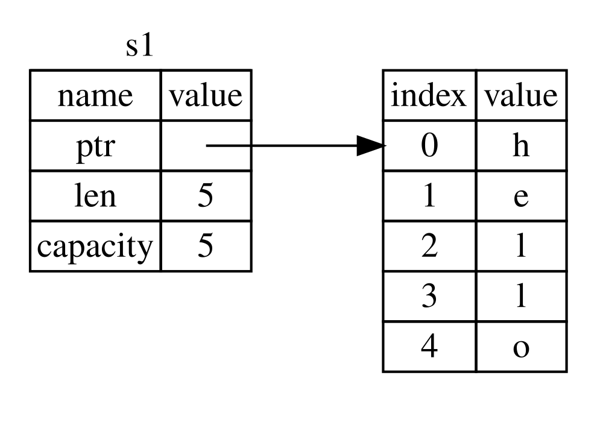
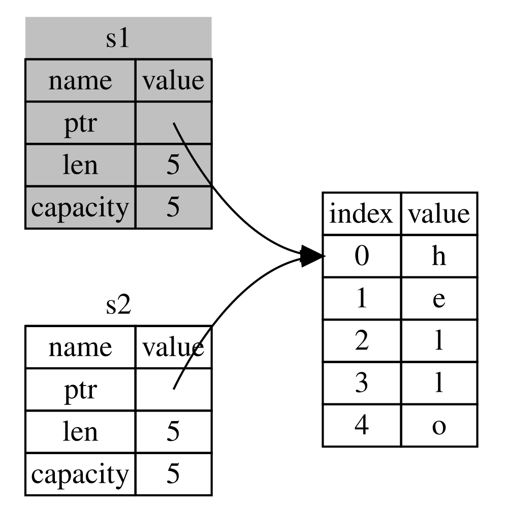

# The Borrow checker

> Previous: [Control Flow](5_flow.md) | Next: [Slices](7_slices.md)

Ownership is how Rust manages memory without a garbage collector. The borrow checker is the component in the Rust compiler that enforces these ownership rules at compile time:

1. Each value in Rust has an *owner* (a variable).
1. There can only be one owner at a time.
1. When the owner goes out of scope, the value will be dropped.

And these rules for references (see [The Rules of References](#the-rules-of-references)):

1. At any given time, you can have either one mutable reference or any number of immutable references.
1. References must always be valid.

## Variable Scope

A variable is valid from the point at which it’s declared until the end of the current scope.

```rust
fn main() {
    {                      // s is not valid here, it’s not yet declared
        let s = "hello";   // s is valid from this point forward
        println!("{s}");   // do stuff with s
    }                      // this scope is now over, and s is no longer valid
}
// hello
```

## Stack and Heap

- Values with a size known at compile time (integers, floats, `bool`, `char`, arrays and tuples of those) live on the **stack**.
- Data with a size unknown at compile time or that can grow (`String`, `Vec<T>`, `Box<T>`…) is stored on the **heap**; the stack only keeps a pointer to it.

A `String` is made up of three parts stored on the stack: a *pointer* to the memory that holds the contents of the string, a *length*, and a *capacity*. The contents live on the heap:



When a `String` goes out of scope Rust automatically calls `drop`, which frees the heap memory (like RAII in C++).

## Move

Integers are simple values with a known fixed size. They can be copied:

```rust
let x = 5; // x = 5
let y = x; // y = 5
```

In this example the second line makes a copy of the value in `x` into `y`. Both variables then are equal to 5.

But complex data types are different:

```rust
let s1 = String::from("hello");
let s2 = s1; // s1 was moved into s2
```

This looks very similar to the previous code, so we might assume that the way it works would be the same: that is, the second line would make a copy of the value in `s1` and bind it to `s2`. But this isn’t true.

When we assign `s1` to `s2`, we copy the *pointer*, the *length*, and the *capacity* that are on the stack. We do not copy the data on the heap that the pointer refers to. Instead Rust considers `s1` to no longer be valid, so it won’t try to free the same memory twice (*double free*). This invalidation of the first variable is known as a **move**. In this example, we would say that `s1` was moved into `s2`.



Using `s1` after the move is a compile error:

```rust,compile_fail
fn main() {
    let s1 = String::from("hello");
    let s2 = s1;

    println!("{s1}, world!");
}
// error[E0382]: borrow of moved value: `s1`
//   |
//   |     let s1 = String::from("hello");
//   |         -- move occurs because `s1` has type `String`, which does not implement the `Copy` trait
//   |     let s2 = s1;
//   |              -- value moved here
//   |
//   |     println!("{s1}, world!");
//   |                ^^ value borrowed here after move
//   |
// help: consider cloning the value if the performance cost is acceptable
//   |     let s2 = s1.clone();
```

Assigning a new value to an existing variable drops the old value immediately:

```rust
fn main() {
    let mut s = String::from("hello");
    println!("{s}, world!");

    s = String::from("ahoy"); // "hello" is dropped here
    println!("{s}, world!");
}
// hello, world!
// ahoy, world!
```

## Clone

If we do want to deeply copy the heap data of the `String`, not just the stack data, we can use a common method called `clone`.

```rust
fn main() {
    let s1 = String::from("hello");
    let s2 = s1.clone();

    println!("s1 = {s1}, s2 = {s2}");
}
// s1 = hello, s2 = hello
```

>⚠ If you’ve heard the terms *shallow copy* and *deep copy* while working with other languages, the concept of copying the pointer, length, and capacity without copying the data probably sounds like making a *shallow copy*. But because Rust also invalidates the first variable, instead of being called a *shallow copy*, it’s known as a **move**. Rust never automatically creates deep copies, so automatic copying is cheap.

## Copy types

Types that implement the `Copy` trait are copied instead of moved, so the original variable is still valid:

- All integer types (`u32`, `i64`…), `bool`, all floating-point types (`f64`…) and `char`.
- Shared references `&T`.
- Tuples and arrays, if they only contain `Copy` types: `(i32, i32)` is `Copy`, `(i32, String)` is not.

A type can’t be `Copy` if it (or any of its parts) implements `Drop`. Your own types can be made `Copy` with `#[derive(Clone, Copy)]` (see [Structs](8_structs.md)).

## Ownership and Functions

The semantics for passing a value to a function are similar to those for assigning a value to a variable:

- `Copy` values -> Are copied.
- Other types -> Are moved.

```rust
fn main() {
    let s = String::from("hello");  // s comes into scope

    takes_ownership(s);             // s's value moves into the function...
                                    // ... and so is no longer valid here

    let x = 5;                      // x comes into scope

    makes_copy(x);                  // because i32 implements Copy, x does
                                    // NOT move into the function, so it’s
                                    // okay to use x afterward
    println!("{x}");

} // Here, x goes out of scope, then s. But because s's value was moved, nothing
  // special happens.

fn takes_ownership(some_string: String) { // some_string comes into scope
    println!("{some_string}");
} // Here, some_string goes out of scope and `drop` is called. The backing
  // memory is freed.

fn makes_copy(some_integer: i32) { // some_integer comes into scope
    println!("{some_integer}");
} // Here, some_integer goes out of scope. Nothing special happens.

// hello
// 5
// 5
```

If we tried to use `s` after the call to `takes_ownership`, Rust would throw a compile-time error. These static checks protect us from mistakes.

## Return values and Scope

Returning values can also transfer ownership.

```rust
fn main() {
    let s1 = gives_ownership();         // gives_ownership moves its return
                                        // value into s1

    let s2 = String::from("hello");     // s2 comes into scope

    let s3 = takes_and_gives_back(s2);  // s2 is moved into
                                        // takes_and_gives_back, which also
                                        // moves its return value into s3

    println!("{s1} {s3}");
} // Here, s3 goes out of scope and is dropped. s2 goes out of scope but was
  // moved, so nothing happens. s1 goes out of scope and is dropped.

fn gives_ownership() -> String {             // gives_ownership will move its
                                             // return value into the function
                                             // that calls it

    let some_string = String::from("yours"); // some_string comes into scope

    some_string                              // some_string is returned and
                                             // moves out to the calling
                                             // function
}

// takes_and_gives_back will take a String and return one
fn takes_and_gives_back(a_string: String) -> String { // a_string comes into
                                                      // scope

    a_string  // a_string is returned and moves out to the calling function
}
// yours hello
```

## References and Borrowing

Taking ownership and then returning ownership with every function is a bit tedious. What if we want to let a function use a value but not take ownership? It’s quite annoying that anything we pass in also needs to be passed back if we want to use it again, in addition to any data resulting from the body of the function that we might want to return as well.

In Rust a `&` is called a *reference*. A reference is like a pointer: it’s an address we can follow to access the data owned by some other variable. Unlike a pointer, a reference is guaranteed to point to a valid value of a particular type for the life of that reference. We call the action of creating a reference **borrowing**. As in real life, if a person owns something, you can borrow it from them. When you’re done, you have to give it back.

```rust
fn main() {
    let s1 = String::from("hello");
    let len = calculate_length(&s1);

    println!("The length of '{s1}' is {len}."); // s1 is still valid
}

fn calculate_length(s: &String) -> usize { // s is a reference to a String
    s.len()
} // Here, s goes out of scope. But because it does not have ownership of what
  // it refers to, the String is not dropped.

// The length of 'hello' is 5.
```

The `&s1` syntax lets us create a reference that refers to the value of `s1` but does not own it. Because it does not own it, the value it points to will not be dropped when the reference goes out of scope.

> In real code prefer `fn calculate_length(s: &str)`: it accepts both `&String` and string literals (see [Slices](7_slices.md#string-slices-as-parameters)).

## Mutable References

Just as variables are immutable by default, so are references. We’re not allowed to modify something we have a reference to:

```rust,compile_fail
fn main() {
    let s = String::from("hello");
    change(&s);
}

fn change(some_string: &String) {
    some_string.push_str(", world");
}
// error[E0596]: cannot borrow `*some_string` as mutable, as it is behind a `&` reference
```

To do so, the variable must be `mut` and you have to create a mutable reference `&mut`:

```rust
fn main() {
    let mut s = String::from("hello");

    change(&mut s);

    println!("{s}");
}

fn change(some_string: &mut String) {
    some_string.push_str(", world");
}
// hello, world
```

But mutable references have one big restriction: you can have only one mutable reference to a particular piece of data at a time. This code will fail:

```rust,compile_fail
fn main() {
    let mut s = String::from("hello");

    let r1 = &mut s;
    let r2 = &mut s;

    println!("{r1}, {r2}");
}
// error[E0499]: cannot borrow `s` as mutable more than once at a time
```

The benefit of having this restriction is that Rust can prevent data races at compile time.

We can use curly brackets to create a new scope, allowing for multiple mutable references, just not simultaneous ones:

```rust
fn main() {
    let mut s = String::from("hello");

    {
        let r1 = &mut s;
        r1.push('!');
    } // r1 goes out of scope here, so we can make a new reference with no problems.

    let r2 = &mut s;
    r2.push('?');

    println!("{s}");
}
// hello!?
```

A similar rule exists for combining mutable and immutable references. This code results in an error:

```rust,compile_fail
fn main() {
    let mut s = String::from("hello");

    let r1 = &s; // no problem
    let r2 = &s; // no problem
    let r3 = &mut s; // BIG PROBLEM

    println!("{r1}, {r2}, and {r3}");
}
// error[E0502]: cannot borrow `s` as mutable because it is also borrowed as immutable
```

Multiple immutable references are okay because no one who is just reading the data has the ability to affect anyone else’s reading of the data.

Note that a reference's scope starts from where it is introduced and continues through the last time that reference is used (*non-lexical lifetimes*). For instance, this code will compile because the last usage of the immutable references occurs before the mutable reference is introduced:

```rust
fn main() {
    let mut s = String::from("hello");

    let r1 = &s; // no problem
    let r2 = &s; // no problem
    println!("{r1} and {r2}");
    // r1 and r2 are no longer used after this point

    let r3 = &mut s; // no problem
    r3.push_str(" world");
    println!("{r3}");
}
// hello and hello
// hello world
```

## Dangling References

A dangling reference points to memory that has been freed. The compiler guarantees that the data will not go out of scope before the reference to it does:

```rust,compile_fail
fn main() {
    let reference_to_nothing = dangle();
}

fn dangle() -> &String {          // returns a reference to a String
    let s = String::from("hello");
    &s                            // we return a reference to s...
} // ...but s goes out of scope and is dropped here
// error[E0106]: missing lifetime specifier
//   = help: this function's return type contains a borrowed value, but there is no value for it to be borrowed from
```

The solution is to return the `String` itself, moving ownership out:

```rust
fn no_dangle() -> String {
    String::from("hello")
}

fn main() {
    println!("{}", no_dangle());
}
// hello
```

## The Rules of References

Let’s recap what we’ve discussed about references:

1. At any given time, you can have either one mutable reference or any number of immutable references.
2. References must always be valid.
