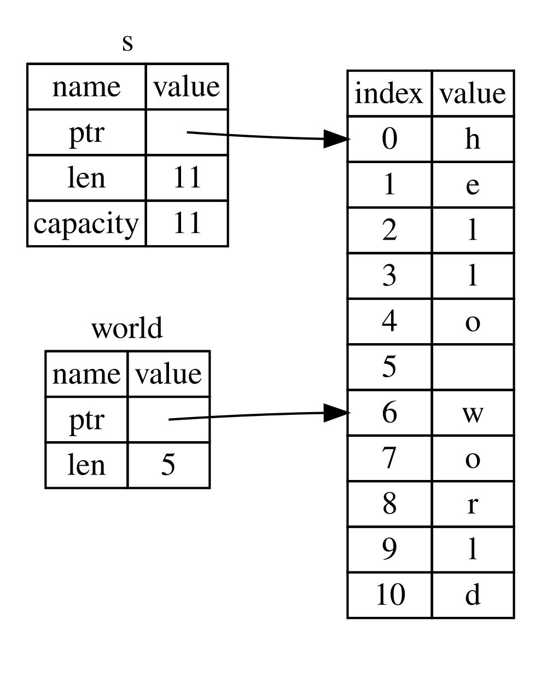

# The Slice Type

> Previous: [Ownership](6_ownership.md) | Next: [Structs](8_structs.md)

Slices let you reference a contiguous sequence of elements in a collection rather than the whole collection. A slice is a kind of reference, so it does not have ownership.

## String Slices

A *string slice* (`&str`) is a reference to part of a `String`:

```rust
fn main() {
    let s = String::from("hello world");

    let hello = &s[0..5];
    let world = &s[6..11];

    println!("{hello} | {world}");
}
// hello | world
```

We can create slices using a range within brackets by specifying `[starting_index..ending_index]`, where:

- `starting_index` is the first position in the slice and
- `ending_index` is one more than the last position in the slice.

Internally, the slice data structure stores the starting position and the length of the slice.



## Range syntax

These pairs are equal:

```rust
fn main() {
    let s = String::from("hello");
    let len = s.len();

    // from start
    let slice = &s[0..2];
    let slice2 = &s[..2];
    assert_eq!(slice, slice2); // "he"

    // to the end
    let slice = &s[3..len];
    let slice2 = &s[3..];
    assert_eq!(slice, slice2); // "lo"

    // entire string
    let slice = &s[0..len];
    let slice2 = &s[..];
    assert_eq!(slice, slice2); // "hello"

    // inclusive end
    assert_eq!(&s[0..=1], "he");
}
```

> ⚠ String slice indices are **byte** positions and must fall on UTF-8 character boundaries. `&"ñandú"[0..1]` panics: `byte index 1 is not a char boundary`. Use `s.chars()` to work with characters.

## String literals are slices

```rust
let s: &str = "Hello, world!";
```

The type of `s` is `&str`: a slice pointing to that specific point of the binary. This is also why string literals are immutable.

## String slices as parameters

Taking a `&str` instead of a `&String` makes a function work with both `String` values and literals (a `&String` is automatically converted to `&str`, *deref coercion*):

```rust
fn first_word(s: &str) -> &str {
    let bytes = s.as_bytes();

    for (i, &item) in bytes.iter().enumerate() {
        if item == b' ' {
            return &s[..i];
        }
    }

    &s[..]
}

fn main() {
    let my_string = String::from("hello world");

    println!("{}", first_word(&my_string));        // &String
    println!("{}", first_word(&my_string[6..]));   // slice of a String
    println!("{}", first_word("rust is fun"));     // string literal
}
// hello
// world
// rust
```

> In practice you can write `s.split(' ').next().unwrap_or("")` or `s.split_whitespace().next()`.

Because the slice borrows the `String`, the borrow checker prevents the `String` from being modified while the slice is in use:

```rust,compile_fail
fn first_word(s: &str) -> &str {
    s.split(' ').next().unwrap_or("")
}

fn main() {
    let mut s = String::from("hello world");

    let word = first_word(&s); // immutable borrow

    s.clear(); // error! mutable borrow while `word` is still in use

    println!("the first word is: {word}");
}
// error[E0502]: cannot borrow `s` as mutable because it is also borrowed as immutable
```

## Other Slices

String slices, as you might imagine, are specific to strings. But there’s a more general slice type, too. Consider this array:

```rust
let a = [1, 2, 3, 4, 5];
```

Just as we might want to refer to a part of a string, we might want to refer to part of an array. We’d do so like this:

```rust
fn main() {
    let a = [1, 2, 3, 4, 5];

    let slice = &a[1..3];

    assert_eq!(slice, &[2, 3]);
    println!("{slice:?}");
}
// [2, 3]
```

This slice has the type `&[i32]`. It works the same way as string slices do, by storing a reference to the first element and a length. You’ll use this kind of slice for all sorts of other collections (`Vec<T>` too).

Mutable slices (`&mut [T]`) allow modifying the elements in place:

```rust
fn double_all(values: &mut [i32]) {
    for v in values.iter_mut() {
        *v *= 2;
    }
}

fn main() {
    let mut v = vec![3, 1, 2];
    double_all(&mut v[1..]); // only the last two
    println!("{v:?}");

    v.sort(); // `sort` is a slice method
    println!("{v:?}");
}
// [3, 2, 4]
// [2, 3, 4]
```

## Slice methods

> [Rust official doc](https://doc.rust-lang.org/std/primitive.slice.html)

```rust
use std::mem;

// This function borrows a slice
fn analyze_slice(slice: &[i32]) {
    println!("first element of the slice: {}", slice[0]);
    println!("the slice has {} elements", slice.len());
}

fn main() {
    // Fixed-size array (type signature is superfluous)
    let xs: [i32; 5] = [1, 2, 3, 4, 5];

    // All elements can be initialized to the same value
    let ys: [i32; 500] = [0; 500];

    // Indexing starts at 0
    println!("first element of the array: {}", xs[0]);
    println!("second element of the array: {}", xs[1]);

    // `len` returns the size of the array
    println!("array size: {}", xs.len());

    // Arrays are stack allocated
    println!("array occupies {} bytes", mem::size_of_val(&xs));

    // Arrays can be automatically borrowed as slices
    println!("borrow the whole array as a slice");
    analyze_slice(&xs);

    // Slices can point to a section of an array
    println!("borrow a section of the array as a slice");
    analyze_slice(&ys[1..4]);

    // Last valid index is len - 1
    println!("{}", xs[4]);

    // Out of bound indexing with a constant index causes a compile error:
    // println!("{}", xs[5]);
    // error: this operation will panic at runtime: index out of bounds: the length is 5 but the index is 5
}
// first element of the array: 1
// second element of the array: 2
// array size: 5
// array occupies 20 bytes
// borrow the whole array as a slice
// first element of the slice: 1
// the slice has 5 elements
// borrow a section of the array as a slice
// first element of the slice: 0
// the slice has 3 elements
// 5
```

Other common methods:

```rust
fn main() {
    let v = [5, 1, 4, 2, 3];

    println!("{:?} {:?}", v.first(), v.last());      // Option, None if empty
    println!("{:?}", v.get(10));                     // safe indexing
    println!("{}", v.contains(&4));
    println!("{:?}", v.iter().position(|&x| x == 4));
    println!("{:?}", v.iter().max());
    println!("{}", v.iter().sum::<i32>());

    let (left, right) = v.split_at(2);
    println!("{left:?} {right:?}");

    for w in v.windows(2) {       // overlapping
        print!("{w:?} ");
    }
    println!();

    for c in v.chunks(2) {        // non-overlapping, the last one may be shorter
        print!("{c:?} ");
    }
    println!();

    let mut sorted = v.to_vec();  // copy into a Vec
    sorted.sort_unstable();
    println!("{sorted:?} is_empty={}", sorted.is_empty());

    if let [first, .., last] = &v[..] { // slice patterns (a slice may be empty)
        println!("{first}..{last}");
    }
}
// Some(5) Some(3)
// None
// true
// Some(2)
// Some(5)
// 15
// [5, 1] [4, 2, 3]
// [5, 1] [1, 4] [4, 2] [2, 3]
// [5, 1] [4, 2] [3]
// [1, 2, 3, 4, 5] is_empty=false
// 5..3
```
