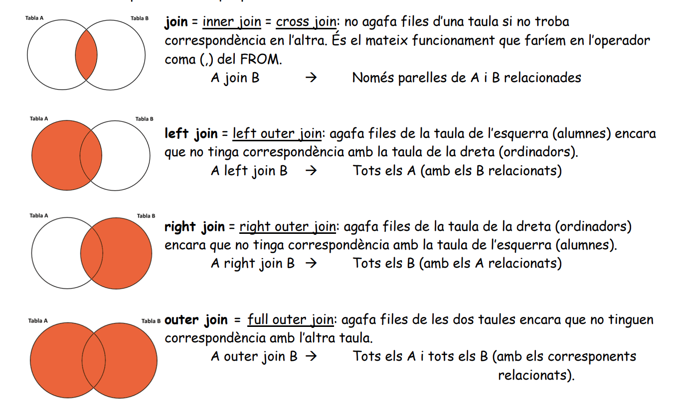

# Joins



Dialect: SQL Server (T-SQL). Differences with MySQL / PostgreSQL are noted inline.
See also: [Consultes multitaula (MySQL)](../fp/Queries/Consultes.md), [Subconsultes](../fp/Queries/Subconsultes.md), [CTE](CTE.md).

## Sample tables

```sql
-- ASSIGNATURES = codi + nom
-- ALUMNES      = num + nom + grup + delegat
-- MATRICULES   = alu + assig + nota
--     FK: alu     -> ALUMNES(num)
--         assig   -> ASSIGNATURES(codi)
--         delegat -> ALUMNES(num)   (self reference)

CREATE TABLE alumnes (
    num     INT PRIMARY KEY,
    nom     NVARCHAR(30) NOT NULL,
    grup    NVARCHAR(5),
    delegat INT NULL REFERENCES alumnes(num)
);
CREATE TABLE assignatures (
    codi INT PRIMARY KEY,
    nom  NVARCHAR(30) NOT NULL
);
CREATE TABLE matricules (
    alu   INT REFERENCES alumnes(num),
    assig INT REFERENCES assignatures(codi),
    nota  DECIMAL(4,2),
    PRIMARY KEY (alu, assig)
);

INSERT INTO alumnes VALUES (1, 'Anna', '1DAM', NULL), (2, 'Pep', '1DAM', 1),
                           (3, 'Maria', '2DAM', NULL), (4, 'Joan', '2DAM', 3);
INSERT INTO assignatures VALUES (10, 'BD'), (20, 'Programació'), (30, 'Sistemes');
INSERT INTO matricules VALUES (1, 10, 8), (1, 20, 7), (2, 10, 5), (3, 20, 9);
-- Joan (4) has no enrolments; Sistemes (30) has no students.
```

## INNER JOIN

Only rows that match on both sides. `JOIN` = `INNER JOIN`.

```sql
SELECT a.nom AS alumne, s.nom AS assignatura, m.nota
FROM alumnes a
INNER JOIN matricules m   ON m.alu  = a.num
INNER JOIN assignatures s ON s.codi = m.assig;
```

| alumne | assignatura | nota |
| ------ | ----------- | ---- |
| Anna   | BD          | 8    |
| Anna   | Programació | 7    |
| Pep    | BD          | 5    |
| Maria  | Programació | 9    |

> Old style `FROM a, b WHERE a.x = b.x` is equivalent to an inner join, but explicit `JOIN ... ON` is clearer and avoids accidental cross joins.

## LEFT (OUTER) JOIN

All rows from the left table; columns from the right are `NULL` when there is no match.

```sql
SELECT a.nom AS alumne, m.assig, m.nota
FROM alumnes a
LEFT JOIN matricules m ON m.alu = a.num;
```

| alumne | assig | nota |
| ------ | ----- | ---- |
| Anna   | 10    | 8    |
| Anna   | 20    | 7    |
| Pep    | 10    | 5    |
| Maria  | 20    | 9    |
| Joan   | NULL  | NULL |

**Anti-join** (rows without a match), e.g. students without enrolments:

```sql
SELECT a.nom
FROM alumnes a
LEFT JOIN matricules m ON m.alu = a.num
WHERE m.alu IS NULL;          -- Joan

-- Equivalent, often clearer:
SELECT a.nom FROM alumnes a
WHERE NOT EXISTS (SELECT 1 FROM matricules m WHERE m.alu = a.num);
```

⚠ **ON vs WHERE in outer joins**: a filter on the right table in `WHERE` turns the LEFT JOIN into an INNER JOIN. Put it in `ON` to keep all left rows.

```sql
-- Keeps every student; only grades >= 7 are joined
SELECT a.nom, m.assig, m.nota
FROM alumnes a
LEFT JOIN matricules m ON m.alu = a.num AND m.nota >= 7;
-- Anna 10 8 | Anna 20 7 | Pep NULL NULL | Maria 20 9 | Joan NULL NULL

-- Pep and Joan disappear (NULL >= 7 is not TRUE)
SELECT a.nom, m.assig, m.nota
FROM alumnes a
LEFT JOIN matricules m ON m.alu = a.num
WHERE m.nota >= 7;
-- Anna 10 8 | Anna 20 7 | Maria 20 9
```

## RIGHT (OUTER) JOIN

Mirror of LEFT JOIN: all rows from the right table. Usually rewritten as a LEFT JOIN swapping the tables.

```sql
SELECT m.alu, s.nom AS assignatura
FROM matricules m
RIGHT JOIN assignatures s ON s.codi = m.assig;
```

| alu  | assignatura |
| ---- | ----------- |
| 1    | BD          |
| 2    | BD          |
| 1    | Programació |
| 3    | Programació |
| NULL | Sistemes    |

## FULL (OUTER) JOIN

All rows from both sides, matched where possible.

```sql
SELECT a.nom AS alumne, s.nom AS assignatura
FROM alumnes a
LEFT JOIN matricules m    ON m.alu  = a.num
FULL JOIN assignatures s  ON s.codi = m.assig;
```

| alumne | assignatura |
| ------ | ----------- |
| Anna   | BD          |
| Anna   | Programació |
| Pep    | BD          |
| Maria  | Programació |
| Joan   | NULL        |
| NULL   | Sistemes    |

> MySQL has no `FULL JOIN`: emulate it with `LEFT JOIN ... UNION ... RIGHT JOIN` (see [Consultes](../fp/Queries/Consultes.md#full-outer-join-en-mysql)). PostgreSQL and SQL Server support it.

## CROSS JOIN

Cartesian product: every row of A with every row of B (4 alumnes x 3 assignatures = 12 rows). Useful to generate combinations.

```sql
-- Every student/subject combination that has NO enrolment
SELECT a.nom AS alumne, s.nom AS assignatura
FROM alumnes a
CROSS JOIN assignatures s
WHERE NOT EXISTS (SELECT 1 FROM matricules m
                  WHERE m.alu = a.num AND m.assig = s.codi);
```

## Self join

A table joined with itself, using two aliases. Typical for hierarchies (employee/manager).

```sql
SELECT a.nom AS alumne, d.nom AS delegat
FROM alumnes a
LEFT JOIN alumnes d ON d.num = a.delegat;
```

| alumne | delegat |
| ------ | ------- |
| Anna   | NULL    |
| Pep    | Anna    |
| Maria  | NULL    |
| Joan   | Maria   |

For multi-level hierarchies use a [recursive CTE](CTE.md#recursive-cte).

## CROSS APPLY / OUTER APPLY (SQL Server)

`APPLY` runs a table expression **once per row** of the left table, and that expression can reference the left row's columns.

- `CROSS APPLY` ~ inner join (left rows with no result are dropped).
- `OUTER APPLY` ~ left join (left rows kept, `NULL`s on the right).

```sql
-- Best grade of each student (top-N per group)
SELECT a.nom, best.assig, best.nota
FROM alumnes a
OUTER APPLY (
    SELECT TOP (1) m.assig, m.nota
    FROM matricules m
    WHERE m.alu = a.num
    ORDER BY m.nota DESC
) AS best;
```

| nom   | assig | nota |
| ----- | ----- | ---- |
| Anna  | 10    | 8    |
| Pep   | 10    | 5    |
| Maria | 20    | 9    |
| Joan  | NULL  | NULL |

With `CROSS APPLY` Joan would not appear.

Other common uses:

```sql
-- Split a delimited column (STRING_SPLIT: SQL Server 2016+)
SELECT p.Id, s.value AS tag
FROM Posts p
CROSS APPLY STRING_SPLIT(p.Tags, ',') AS s;

-- Unpivot columns into rows
SELECT p.ProductID, v.Year, v.Sales
FROM SalesWide p
CROSS APPLY (VALUES (2020, p.[2020]), (2021, p.[2021])) AS v(Year, Sales);
```

> Equivalents: PostgreSQL and MySQL 8.0.14+ use `JOIN LATERAL (...) ON TRUE` / `LEFT JOIN LATERAL (...) ON TRUE`.
> The same "top 1 per group" can also be done with `ROW_NUMBER()` (see [window functions](snippets.md#window-functions)).
