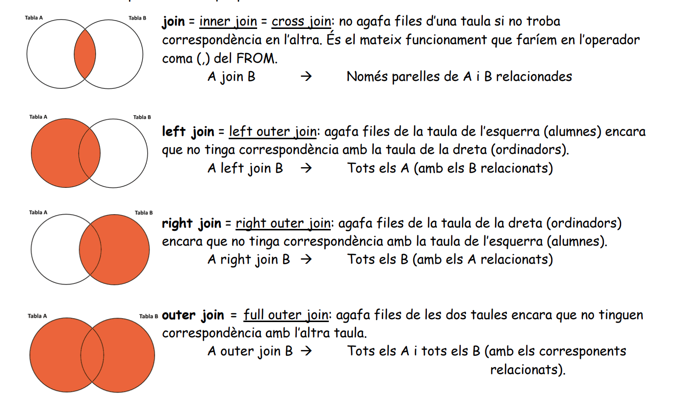

# Consultes

Dialecte: MySQL 8 (la major part és SQL estàndard). Vegeu també: [Subconsultes](Subconsultes.md), [Joins (SQL Server, amb resultats)](../../Snippets/Joins.md), [Resum SQL](../fp%20sql.md), [Vistes](../vistes.md).

```sql
SELECT ...      -- camps, expressions o funcions d'agregat
FROM ...        -- taules
WHERE ...       -- condicions sobre les files
GROUP BY ...    -- camp(s) pels quals s'agrupa
HAVING ...      -- condicions sobre els grups
ORDER BY ...    -- ordenació del resultat
LIMIT ...       -- nombre màxim de files (MySQL/PostgreSQL; en SQL Server: TOP / OFFSET-FETCH)
```

## Taules d'exemple

```sql
CREATE TABLE pobles (
    cpostal CHAR(5) PRIMARY KEY,
    nom     VARCHAR(40) NOT NULL,
    comarca VARCHAR(40)
);
CREATE TABLE alumnes (
    num  INT PRIMARY KEY,
    nom  VARCHAR(30) NOT NULL,
    grup VARCHAR(5),
    edat INT,
    cp   CHAR(5),
    FOREIGN KEY (cp) REFERENCES pobles (cpostal)
);

INSERT INTO pobles VALUES ('46410', 'Sueca', 'Ribera Baixa'),
                          ('46600', 'Alzira', 'Ribera Alta'),
                          ('46700', 'Gandia', 'Safor');
INSERT INTO alumnes VALUES (1, 'Anna', '1DAM', 19, '46410'),
                           (2, 'Pep', '1DAM', 17, '46600'),
                           (3, 'Maria', '2DAM', 21, '46410'),
                           (4, 'Joan', '2DAM', 20, NULL);
```

## GROUP BY, HAVING i ORDER BY

### GROUP BY

GROUP BY agrupa les files que tenen els mateixos valors en els camps indicats i torna **una fila per grup**. Normalment s'usa amb funcions d'agregat: `COUNT()`, `SUM()`, `MIN()`, `MAX()`, `AVG()`...

```sql
SELECT grup, COUNT(*) AS alumnes, AVG(edat) AS edat_mitjana
FROM alumnes
GROUP BY grup;
```

| grup | alumnes | edat_mitjana |
| ---- | ------- | ------------ |
| 1DAM | 2       | 18.0000      |
| 2DAM | 2       | 20.5000      |

⚠ En la SELECT només poden aparéixer camps del GROUP BY o funcions d'agregat (MySQL 8 ho exigeix per defecte amb `ONLY_FULL_GROUP_BY`).

### HAVING

Si la clàusula WHERE descarta files, la clàusula HAVING descarta grups: en la condició del HAVING indiquem què ha de complir un grup per a no ser descartat. Normalment va amb GROUP BY (sense GROUP BY, tota la taula és un únic grup).

```sql
SELECT grup, COUNT(*) AS alumnes
FROM alumnes
WHERE edat >= 18          -- filtra files abans d'agrupar
GROUP BY grup
HAVING COUNT(*) > 1;      -- filtra grups
-- 2DAM | 2
```

### ORDER BY

Podem ordenar per qualsevol element de la clàusula SELECT (també pel seu àlies) o per qualsevol camp de les taules del FROM (encara que no estiga en la SELECT).
Si no s'indica DESC ni ASC, per defecte és ASC.

```sql
SELECT nom, edat
FROM alumnes
ORDER BY edat DESC, nom
LIMIT 2;                  -- les 2 primeres files: Maria 21, Joan 20
-- LIMIT 2 OFFSET 2  -> les files 3 i 4 (paginació)
```

## UNION

Podem "unir" dos o més consultes en una sola: a partir del conjunt de resultats d'una SELECT i del d'una altra SELECT obtenim un únic conjunt de resultats.

- Totes les SELECT han de tindre el mateix nombre de columnes, i de tipus compatibles. Els noms de columna són els de la primera SELECT.
- `UNION` elimina les files duplicades; `UNION ALL` les manté (i és més ràpid).
- L'ORDER BY va al final i s'aplica al resultat complet.

```sql
SELECT nom, 'alumne' AS tipus FROM alumnes
UNION ALL
SELECT nom, 'poble' FROM pobles
ORDER BY nom;
```

> MySQL 8.0.31+ també té `INTERSECT` i `EXCEPT` (SQL Server i PostgreSQL ja els tenien).

## Consultes compostes o multitaula

Consultes de dos o més taules. Com que la informació està en 2 taules (o més), haurem de:

- Posar les 2 taules en el **FROM**.
- Posar en el **WHERE** com estan relacionades les 2 taules: sol ser una condició sobre la clau aliena.

Exemple:

```sql
-- Tenim:
-- POBLES  = cpostal + nom + comarca
-- ALUMNES = num + nom + grup + edat + cp
--     C. Ali: cp -> POBLES (cpostal)

-- Volem el nom de l'alumne i el nom del poble on viu:
SELECT alumnes.nom, pobles.nom
FROM alumnes, pobles
WHERE alumnes.cp = pobles.cpostal;
```

| nom   | nom    |
| ----- | ------ |
| Anna  | Sueca  |
| Pep   | Alzira |
| Maria | Sueca  |

(Joan no ix perquè no té `cp`.)

Amb àlies de taula i de columna és més curt i llegible:

```sql
SELECT a.nom AS alumne, p.nom AS poble
FROM alumnes a, pobles p
WHERE a.cp = p.cpostal;
```

Exemple amb més de dos taules:

```sql
-- ASSIGNATURES = codi + nom
-- ALUMNES      = num + nom + grup + cp
-- MATRICULES   = alu + assig + nota
--     C. Ali: alu   -> ALUMNES(num)
--             assig -> ASSIGNATURES(codi)

-- Volem obtindre de cada alumne el seu nom i el nom de les assignatures on està matriculat:
SELECT alumnes.nom, assignatures.nom
FROM alumnes, assignatures, matricules
WHERE alumnes.num = matricules.alu
  AND matricules.assig = assignatures.codi;
```

⚠ Amb N taules calen, com a mínim, N-1 condicions de relació. Si n'oblidem una, obtenim el producte cartesià (totes les combinacions).

### JOIN

Hi ha una altra forma de fer les composicions de taules: l'ús de JOIN. Separa la condició de relació (ON) dels filtres (WHERE).

Per exemple, estes dos sentències trauen el mateix resultat:

```sql
SELECT alumnes.*, pobles.nom, pobles.comarca
FROM alumnes, pobles
WHERE alumnes.cp = pobles.cpostal AND alumnes.edat > 17;
```

```sql
SELECT alumnes.*, pobles.nom, pobles.comarca
FROM alumnes JOIN pobles ON alumnes.cp = pobles.cpostal
WHERE alumnes.edat > 17;
```

Si els camps es diuen igual en les dos taules, es pot usar `USING (camp)` en lloc de `ON`.

#### Tipus de joins



| Tipus        | Resultat                                                             |
| ------------ | -------------------------------------------------------------------- |
| `INNER JOIN` | Només les files que coincideixen en les dos taules                   |
| `LEFT JOIN`  | Totes les de l'esquerra; les de la dreta a `NULL` si no coincideixen |
| `RIGHT JOIN` | Totes les de la dreta; les de l'esquerra a `NULL` si no coincideixen |
| `FULL JOIN`  | Totes les files de les dos taules (no existeix en MySQL)             |
| `CROSS JOIN` | Producte cartesià                                                    |

```sql
-- Tots els alumnes, tinguen poble o no
SELECT a.nom, p.nom AS poble
FROM alumnes a LEFT JOIN pobles p ON a.cp = p.cpostal;
-- Anna Sueca | Pep Alzira | Maria Sueca | Joan NULL

-- Pobles on no viu cap alumne
SELECT p.nom
FROM pobles p LEFT JOIN alumnes a ON a.cp = p.cpostal
WHERE a.num IS NULL;
-- Gandia
```

#### FULL OUTER JOIN en MySQL

MySQL no té `FULL OUTER JOIN` (en cap versió). La solució és fer un `UNION` de la LEFT i de la RIGHT:

```sql
SELECT a.nom, p.nom AS poble
FROM alumnes a LEFT JOIN pobles p ON a.cp = p.cpostal

UNION

SELECT a.nom, p.nom
FROM alumnes a RIGHT JOIN pobles p ON a.cp = p.cpostal;
-- Anna Sueca | Pep Alzira | Maria Sueca | Joan NULL | NULL Gandia
```

⚠ Si cal filtrar (p. ex. `edat > 17`), fes-ho en una subconsulta o en el `ON`, no en el `WHERE` de la part RIGHT: `WHERE edat > 17` descartaria les files on `edat` és `NULL` (els pobles sense alumnes), que són justament les que volíem afegir.

## CTE i funcions de finestra (MySQL 8)

Des de MySQL 8.0 es poden usar `WITH` (CTE) i funcions de finestra (`OVER`). Vegeu [CTE](../../Snippets/CTE.md) i [funcions de finestra](../../Snippets/snippets.md#window-functions).

```sql
-- Alumne més major de cada grup
WITH ordenats AS (
    SELECT nom, grup, edat,
           ROW_NUMBER() OVER (PARTITION BY grup ORDER BY edat DESC) AS n
    FROM alumnes
)
SELECT grup, nom, edat FROM ordenats WHERE n = 1;
-- 1DAM Anna 19 | 2DAM Maria 21
```
